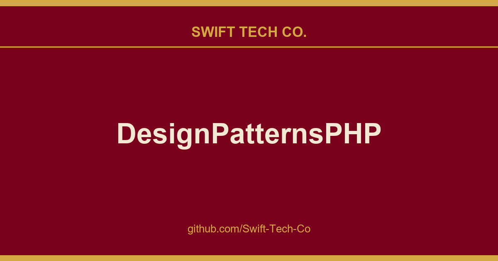

# DesignPatternsPHP

## What This Is

A practical reference entry for product and engineering: the DesignPatternsPHP notes, examples and fixes we reach for repeatedly. Kept current as part of the wider Swift Tech Co. engineering library.

## Images

[](https://github.com/Swift-Tech-Co)

## Installation
You should look at and run the tests to see what happens in the example.
To do this, you should install dependencies with `Composer` first:

```bash
$ composer install
```

Read more about how to install and use `Composer` on your local machine here.

To run the tests use `phpunit`:

```bash
$ ./vendor/bin/phpunit
```

## Using Docker (optional)

You can optionally build and browse the documentation using Docker for Mac, Windows or Linux.

Just run:

```bash
$ docker-compose up --build
```

Go to https://www.swifttechco.com to read the generated documentation.

If you want to localize your documentation you can pass the locale as an argument to the docker build:

```bash
$ docker-compose build --build-arg language=de
$ docker-compose up
```

## Patterns

The patterns can be structured in roughly three different categories. Please click on the :notebook: for a full explanation of the pattern on Wikipedia.

### [Creational](Creational)

* [AbstractFactory](Creational/AbstractFactory) :notebook:
* [Builder](Creational/Builder) :notebook:
* [FactoryMethod](Creational/FactoryMethod) :notebook:
* [Pool](Creational/Pool) :notebook:
* [Prototype](Creational/Prototype) :notebook:
* [SimpleFactory](Creational/SimpleFactory)
* [Singleton](Creational/Singleton) :notebook:
* [StaticFactory](Creational/StaticFactory)

### [Structural](Structural)

* [Adapter](Structural/Adapter) :notebook:
* [Bridge](Structural/Bridge) :notebook:
* [Composite](Structural/Composite) :notebook:
* [DataMapper](Structural/DataMapper) :notebook:
* [Decorator](Structural/Decorator) :notebook:
* [DependencyInjection](Structural/DependencyInjection) :notebook:
* [Facade](Structural/Facade) :notebook:
* [FluentInterface](Structural/FluentInterface) :notebook:
* [Flyweight](Structural/Flyweight) :notebook:
* [Proxy](Structural/Proxy) :notebook:
* [Registry](Structural/Registry) :notebook:

### [Behavioral](Behavioral)

* [ChainOfResponsibilities](Behavioral/ChainOfResponsibilities) :notebook:
* [Command](Behavioral/Command) :notebook:
* [Interpreter](Behavioral/Interpreter) :notebook:  
* [Iterator](Behavioral/Iterator) :notebook:
* [Mediator](Behavioral/Mediator) :notebook:
* [Memento](Behavioral/Memento) :notebook:
* [NullObject](Behavioral/NullObject) :notebook:
* [Observer](Behavioral/Observer) :notebook:
* [Specification](Behavioral/Specification) :notebook:
* [State](Behavioral/State) :notebook:
* [Strategy](Behavioral/Strategy) :notebook:
* [TemplateMethod](Behavioral/TemplateMethod) :notebook:
* [Visitor](Behavioral/Visitor) :notebook:

### [More](More)

* [EAV](More/EAV) :notebook:
* [Repository](More/Repository)
* [ServiceLocator](More/ServiceLocator) :notebook:


## Localization & Supported Languages
  The following languages are currently available. However not all are actively supported. 
  The current policy is: if there are no native-speaking maintainers we cannot support the given language. 
  We will still leave the translation as is but we will not update it as the base (English) changes.
  The table below list which language version is considered "supported" and who maintains it.

  We're sorry. We would love to maintain them but it is not possible for us. So if you would like to take care
  of one or more languages - contact us.

| Code  | Language  |    Documentation   |  Actively Supported?  | Maintainer |
| ------------------|-------------|------|-----------------------|------------|
| en    | English   | Docs :notebook: | YES | -- |
| de    | German    | Docs :notebook: | NO | - |
| ca    | Catalan   | Docs :notebook: | NO | - |
| zh_CN | Chinese   | Docs :notebook: | NO | - |
| nl    | Dutch     | Docs :notebook: | NO | - |
| bg    | Bulgarian | Docs :notebook: | YES | -- |
| ja    | Japanese  | Docs :notebook: | NO | - |
| pl    | Polish    | Docs :notebook: | NO | - |
| pt_BR | Portuguese-Brazil | Docs :notebook: | NO | - |
| ru    | Russian   | Docs :notebook: | NO | - |
| es    | Spanish   | Docs :notebook: | NO | - |
| es_MX | Spanish-Mexican | Docs :notebook: | NO | - |
| tr    | Turkish   | Docs :notebook: | NO | - |
| fr    | French | Docs :notebook: | NO | - |
| it    | Italian | Docs :notebook: | NO | - |
| uk    | Ukrainian | Docs :notebook:    | NO | - |

---

## Swift Tech Co.

Built and maintained by Swift Tech Co.

AI Automation | FinTech Platforms | Custom Software and Mobile Apps | SaaS Platforms | Cloud Infrastructure | Cybersecurity | SEO and Marketing | API Integration

**Join our community on Telegram:** [t.me/+Qt_eFvkb2rliMzNh](https://t.me/+Qt_eFvkb2rliMzNh)

Home | Services | Careers | Referral Program | Influencers | About | Contact

**Connect**

- Website: swifttechco.com
- LinkedIn: [linkedin.com/in/stephenoladoke](https://www.linkedin.com/in/stephenoladoke/)
- LinkedIn (Company): [linkedin.com/company/swift-tech-co](https://www.linkedin.com/company/swift-tech-co)
- X: [@MrOladoke](https://x.com/MrOladoke)
- Instagram: [@mr.oladoke](https://www.instagram.com/mr.oladoke/)
- Instagram (Company): [@swifttechco](https://www.instagram.com/swifttechco/)
- Organization: [github.com/Swift-Tech-Co](https://github.com/Swift-Tech-Co)

## Sources

Compiled and maintained from upstream [DesignPatternsPHP/DesignPatternsPHP](https://github.com/DesignPatternsPHP/DesignPatternsPHP) under permissive open-source license.

---

Maintained by [Swift Tech Co.](https://github.com/Swift-Tech-Co) - [Telegram](https://t.me/+Qt_eFvkb2rliMzNh)

## Sources

Compiled and maintained from upstream [DesignPatternsPHP/DesignPatternsPHP](https://github.com/DesignPatternsPHP/DesignPatternsPHP) under permissive open-source license.

---

Maintained by [Swift Tech Co.](https://github.com/Swift-Tech-Co) - [Telegram](https://t.me/+Qt_eFvkb2rliMzNh)